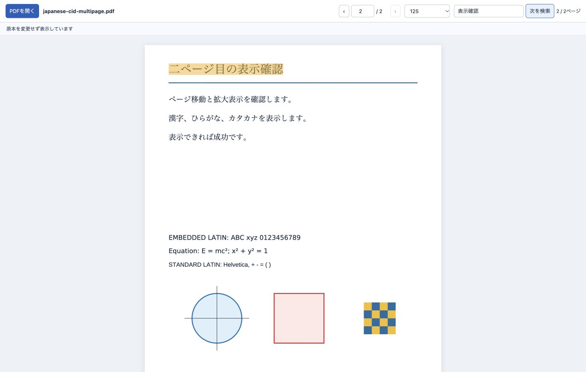

# CJK PDF Viewer

A read-only PDF file-viewer plugin for Codex in the ChatGPT desktop app.
It packages the character maps, standard fonts, and rendering assets needed to
display Japanese and other CJK text, and opens the **original PDF** in a plugin
file panel.

This project is independent of OpenAI. It does not modify the desktop application
or replace its files.

## Why this exists

Some PDFs use named Adobe character maps such as `Adobe-Japan1-UCS2`. A PDF can
contain its Japanese font and still need those maps for a viewer to interpret
the text correctly. In the reproduced failure, a PDF.js loader without its
external font/CMap resources omitted Japanese labels. Supplying the required
resources restored both their rendering and text extraction.

This plugin bundles its PDF.js worker and support data rather than relying on a
CDN or the host application's PDF-viewer configuration. The document is not
converted into an image-only PDF; page rendering and the selectable text layer
are generated from its original bytes.

See the [root-cause investigation](docs/root-cause.md) for the reproduced failure and the distinction between the native preview, SDK replay, and local image conversion.



## Requirements

- A ChatGPT desktop app / Codex version that supports OpenAI MCP file entrypoints.
- macOS or Linux with `/bin/sh`.
- Node.js **22 or later**, installed on PATH, in a standard Homebrew location,
  or under NVM. The launcher also accepts an explicit `CJK_PDF_NODE` path.
- A PDF opened through the desktop host, so it can provide a host-managed file
  resource to the plugin.

File entrypoints are desktop-only in the current OpenAI extension specification.
Do not expect them to work on the web, iOS, Android, or in a headless CLI.

Version 0.1.1 fixes startup in GUI applications that do not inherit an interactive
shell's Node/NVM PATH. The launcher does not source shell profiles or change global
environment settings. Automatic Windows launching is not yet supported by this
Unix launcher; the renderer and bundled server themselves remain portable.

## Install from the GitHub marketplace

Add the marketplace with Codex CLI:

```sh
codex plugin marketplace add O-kAIru/codex-cjk-pdf-viewer
```

Install the plugin from that marketplace:

```sh
codex plugin add codex-cjk-pdf-viewer@cjk-pdf-viewer-marketplace
```

Then reopen the ChatGPT desktop app, or refresh its plugin connections if that
control is available. Open a PDF and select this viewer if the host offers a
choice of file handlers.

The release includes `dist/server.mjs` and `dist/viewer.html`. A plugin user needs
Node.js, but does **not** need to run `npm install`, build the source, obtain an
API key, or run a remote service. See [installation and validation](docs/installation.md).

GitHub marketplace distribution is distinct from listing in OpenAI's public
plugin directory. The latter has a separate submission and review process;
local MCP submissions currently require approved-partner access.

## Use

The plugin registers a `.pdf` file entrypoint. When the host opens a PDF in that
entrypoint, it sends the viewer a filename and an opaque resource URI. The viewer
reads the PDF through the host's resource API and displays it in the thread file
panel. Page navigation, zoom, text selection, and text search operate on the
loaded document.

The plugin is a viewer, not a PDF editor. Saving, rewriting, re-uploading, or
changing the original PDF is outside its scope.

## Privacy and access

- The server exposes one viewer tool and one static HTML resource.
- There are no general filesystem tools, upload endpoints, or network-fetch
  tools in this plugin.
- The server reads only its packaged `dist/viewer.html` file. It does not accept
  a user-supplied filesystem path.
- PDF bytes are obtained in the viewer from the host-authorized opaque resource
  URI. They are not uploaded to a developer-operated service.
- The renderer's worker, CMaps, standard fonts, and WASM resources are bundled.
  Viewing does not require font or PDF requests to a CDN.
- No API key, account connection, or environment variable is required.

These statements describe this plugin's behavior; the desktop host's own data
handling and policies still apply.

## Develop

```sh
npm ci
npm run build
npm test
```

The build produces a self-contained MCP server and HTML viewer in `dist/`.
`server.mjs` is the source entry point. Run the built server with:

```sh
node dist/server.mjs
```

Standard output is reserved for MCP messages. The server reads `viewer.html`
relative to its bundled location, so moving the installed plugin directory does
not require editing a machine-specific path.

Commit the built `dist/` assets when publishing a release so a clean plugin
installation can run without npm or a development toolchain. Preserve third-party
license notices included by the build. Do not commit private documents,
credentials, application binaries, or extracted proprietary application code.

## Validation boundaries

Local protocol and rendering tests do not by themselves establish that a plugin
has been installed successfully in every desktop version. Before claiming a
desktop release is verified, complete the manual file-entrypoint checks in
[installation and validation](docs/installation.md), including opening the PDF
from the actual host and checking text selection and search.

## References

- [OpenAI file-viewer extensions](https://developers.openai.com/plugins/build/extensions)
- [OpenAI MCP Extensions specification](https://github.com/openai/mcp-extensions/blob/main/docs/spec.md#file-extension-entrypoint)
- [Plugin package and marketplace documentation](https://developers.openai.com/plugins/build/plugins)
- [Desktop-only public submission](https://developers.openai.com/plugins/deploy/desktop-only)
- [PDF.js](https://mozilla.github.io/pdf.js/)

## License

The project's own code is MIT licensed. Bundled dependencies retain their own
licenses and notices. See [LICENSE](LICENSE).
